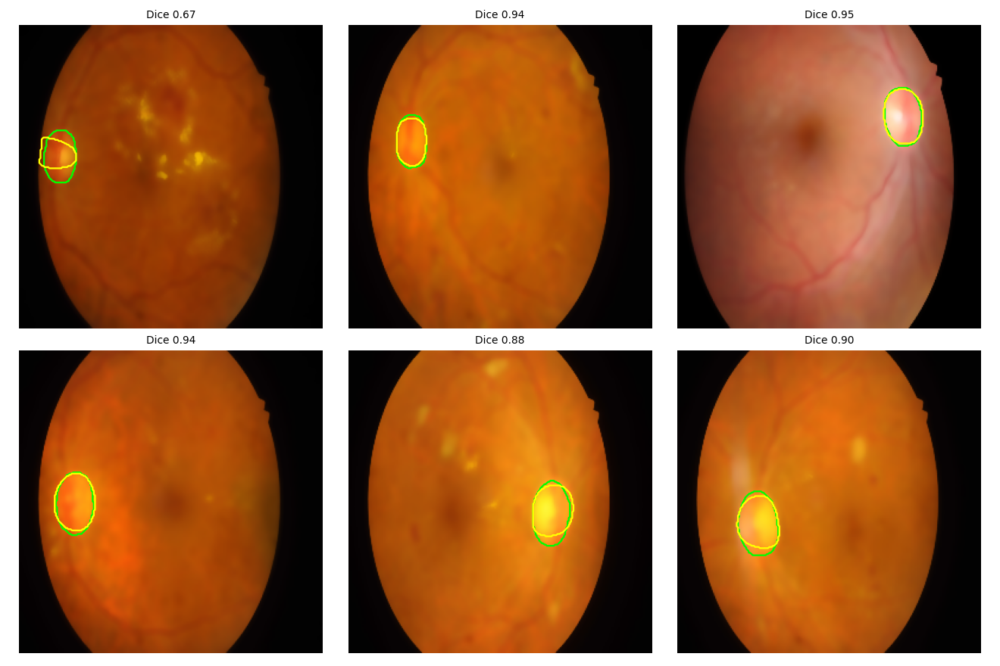
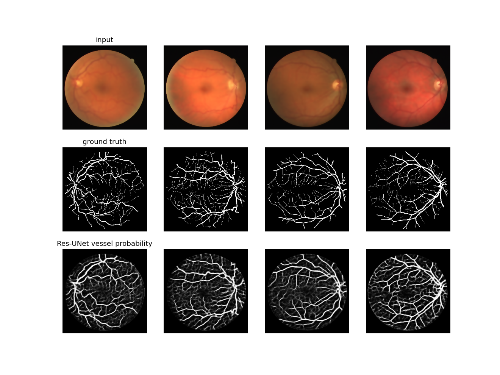
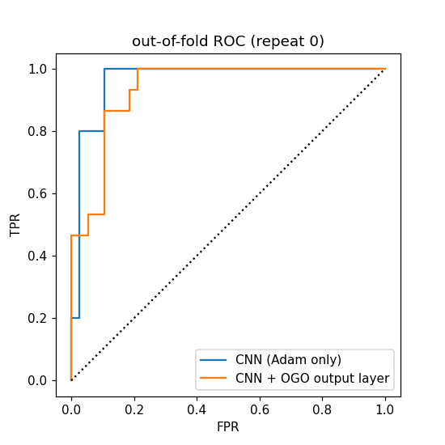

### Retinal Fundus Image Analysis for Hypertension Classification

## Overview
This project explores retinal fundus image analysis using deep learning
and computer vision for optic disc detection, blood vessel segmentation,
and hypertension classification.

## Methodology
- Image preprocessing
- Optic disc detection using active contours
- OGO-based optic disc parameter optimization
- Blood vessel segmentation using Res-UNet with Jaya-CCBOA
- CNN-based hypertension classification
- Model evaluation using classification metrics and ROC curves

## Results

### Optic Disc Detection
Dice score improved from 0.445 to 0.842 after OGO optimization.

### Blood Vessel Segmentation
- Accuracy: 0.906
- Sensitivity: 0.695
- Specificity: 0.935
- AUC: 0.902
- Dice score: 0.642

### Hypertension Classification

**CNN (Adam only)**
- Accuracy: 0.881 ± 0.009
- AUC: 0.961 ± 0.012

**CNN + OGO output layer**
- Accuracy: 0.874 ± 0.018
- AUC: 0.953 ± 0.018

## Visual Results

### Optic Disc Detection

### Blood Vessel Segmentation

### Classification ROC Curve

## Technologies Used
- Python
- PyTorch
- OpenCV
- NumPy
- Matplotlib
- SciPy
- scikit-image
- scikit-learn
